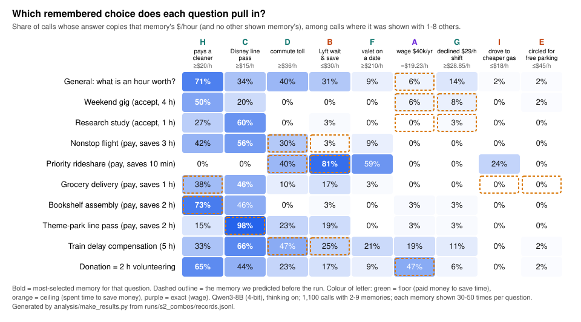

# Agents choosing schemas

**When an AI agent has several remembered experiences it could use to solve a problem, does the
problem in front of it decide which one it uses?**

"How much is an hour of your time worth?" has many defensible answers: your wage, or what you revealed
when you waited 8 minutes to save $4 on a ride, or paid $9 to skip traffic. We gave a reasoning model a
persona plus 0 to 9 such remembered choices, each implying a different dollar value per hour, and asked
ten questions that frame time differently. Because every memory implies a different number, each answer
can be traced back to the memory it came from.

This repository contains everything from that project (21–22 October 2026):

- **all of the data**: every saved run, 1,665 model calls across five runs, each with the exact prompt,
  the model's full thinking trace and its answer, including the pilot and timing runs;
- **our results**, regenerated from that data by one script that needs no model and no network;
- **our interpretation**, in [`my-takeaways.md`](my-takeaways.md), plus the reports and figures we made
  at the time, in [`docs/`](docs/);
- **the exact code** that produced the data, so you can rerun it on your own Mac. No API key is needed:
  the model runs locally.

## The headline result



| question | memory it uses most (share of calls where shown) | what we predicted before the run |
|---|---|---|
| General: what is an hour worth? | cleaner, $20/h (71%) | wage (6%) |
| Weekend gig (lowest pay for 4 h) | cleaner (50%) | wage (6%), declined $29/h shift (8%) |
| Research study (lowest pay for 1 h) | Disney pass, $15/h (60%) | wage (0%), declined shift (3%) |
| Nonstop flight saving 3 h | Disney pass (56%) | Lyft wait (3%), toll (30%) |
| **Priority rideshare, 10 min sooner** | **Lyft wait, $30/h (81%)** | **Lyft wait (81%)**, toll (40%) |
| Grocery delivery saving 1 h | Disney pass (46%) | cleaner (38%), parking (0%), gas (0%) |
| **Bookshelf assembly** | **cleaner (73%)** | **cleaner (73%)** |
| **Theme-park line pass** | **Disney pass (98%)** | **Disney pass (98%)** |
| Train delay compensation | Disney pass (66%) | Lyft wait (25%), toll (47%) |
| Donation equal to 2 h volunteering | cleaner (65%) | wage (47%) |

Calls showing 2 to 9 memories (1,100 calls). A memory counts as used when the answer's implied $/hour
matches it, and no other memory shown, within 3%.

The question does select the memory, **but only when a memory is a close match** (rows in bold). Otherwise
the model falls back on whichever memory gives an easy, plausible rate: the cleaner ($60 ÷ 3 h) or the
Disney pass ($30 ÷ 2 h). The wage, the textbook answer, almost never wins. With more memories it picks
one rather than averaging: none of 380 answers given with 3+ memories equals the average of the
rates shown. Why remembered *savings* turn into a personality trait while remembered *spending* turns
into a price, and what the thinking traces do and don't tell us, are in
**[my-takeaways.md](my-takeaways.md)**.

## Where to look

| if you want… | go to |
|---|---|
| our interpretation | [`my-takeaways.md`](my-takeaways.md) |
| every results table | [`results/RESULTS.md`](results/RESULTS.md) (CSV versions alongside) |
| what each data file and field means | [`runs/DATA.md`](runs/DATA.md) |
| to read what the model was thinking | `runs/s1_single/traces.md`, `runs/s2_combos/traces.md`: every trace, grouped by question |
| the exact prompt, raw output and answer for any call | `runs/*/records.jsonl`, one line per call |
| our write-ups and figures from the time | [`docs/report.html`](docs/report.html), `docs/findings_*.md`, `docs/tldr/`, `docs/figures/`, `docs/presentation_progression.html`, `docs/trace_interpretation.html` |

## The design in one paragraph

The model is Qwen3-8B (4-bit, run locally with Apple's MLX), with thinking on and Qwen's recommended
sampling (temperature 0.6, top-p 0.95, top-k 20). Every prompt has the same persona, "Sam", which
contains no information about money, prices or time. A memory slot holds 0 to 9 remembered choices, each
implying a different value of an hour (from $15 to $210). Most are one-sided: paying to save time reveals
an hour is worth *at least* that much, spending time to save money reveals *at most*. Then comes **one**
survey question, in its own fresh call with no shared context. The prompt never says the memories are
relevant and contains no example numbers. Stage 1 shows no memory or one memory (5 samples per memory ×
question, 500 calls). Stage 2 shows all 36 pairs and three sequences that add memories one at a time up
to all nine (2 samples each, 1,140 calls). Memory order is shuffled across samples.

## Repository layout

```
my-takeaways.md       our interpretation of the results
results/              tables and figure, generated by analysis/make_results.py
analysis/             the script that builds results/ from the saved runs
runs/
  DATA.md             codebook for every data file
  s1_single/          stage 1: no memory or one memory (500 calls)
  s2_combos/          stage 2: pairs and ladders up to all nine (1,140 calls)
  pilot01/            first test, earlier prompt design (3 calls)
  timing_probe/       speed checks (6 and 16 calls)
  timing_batch/
  queue.log           console log of the two main runs
value_of_time/        the experiment: stimuli, design, prompt, model engine, runner, per-run summaries
scripts/              our original analysis and figure scripts, and the queue script that ran stages 1-2
docs/                 our reports, findings and figures from the time (all built from runs/)
tests/                test_value_of_time.py: original unit tests; test_results.py: data reproduces results
```

## Reproduce our results (no model, no key)

Needs only Python 3.9 or newer; no packages.

```bash
python3 analysis/make_results.py      # rewrites results/ from runs/
```

The output is deterministic. `make check` regenerates it and fails if anything differs from the
committed `results/`; `make test` (needs [uv](https://docs.astral.sh/uv/)) also checks the headline
numbers and runs our original unit tests. Both run in CI on every push.

Our original analysis scripts also still work and rebuild our files from the time byte for byte:

```bash
python3 -m value_of_time.analyze runs/s1_single         # answers.csv, summary.md, traces.md
PYTHONPATH=. python3 scripts/analyze_schema.py          # prints the selection analysis; writes docs/tldr_data.json
PYTHONPATH=. python3 scripts/build_report.py            # docs/report.html and docs/slides/*.html
```

(`scripts/build_*.py` write the HTML in `docs/`. The PNGs and the PDF there are browser screenshots and a
print of that HTML, made by hand.)

## Rerun the experiments (Apple Silicon Mac)

The model runs on your own machine through [MLX](https://github.com/ml-explore/mlx), so you need an Apple
Silicon Mac. No API key or account is needed; the first run downloads `mlx-community/Qwen3-8B-4bit` from
Hugging Face.

```bash
make setup                                   # uv sync --extra mlx  (installs mlx-lm 0.32.0)
```

Free and fast, no model needed:

```bash
uv run --group dev pytest -q                 # includes an end-to-end run with the mock engine
uv run python -m value_of_time.run --stages baseline single --reps 1 --engine mock --run-id smoke
```

The mock engine returns random numbers and stamps every record `MOCK ENGINE OUTPUT - NOT EVIDENCE`; it
only tests the plumbing.

The real runs, as we ran them:

```bash
scripts/queue_vot.sh        # stage 1 then stage 2, batch of 8, auto-resumes after GPU out-of-memory crashes
```

or one stage at a time, under new run ids so ours stay untouched:

```bash
uv run --extra mlx python -m value_of_time.run --stages baseline single --reps 5 --engine mlx --batch-size 8 --run-id my_s1
uv run --extra mlx python -m value_of_time.run --stages pairs ladder full --reps 2 --engine mlx --batch-size 8 --run-id my_s2
uv run python -m value_of_time.analyze runs/my_s1
```

Every run is resumable: rerun the same command and it skips finished calls. On our Apple Silicon laptop
(24 GB) a batch of 16 ran out of GPU memory; at a batch of 8, stage 1 took about 2.5 hours and stage 2 about
6.5 hours, including restarts (`runs/queue.log`). `--model` takes any other MLX chat model id; the prompt
asks the chat template for thinking mode, which is Qwen3-specific. Using a non-MLX model would mean adding
an engine to `value_of_time/engines.py` (the mock engine shows the interface).

Three things to know before rerunning:

- **`scripts/queue_vot.sh` uses our run ids** (`s1_single`, `s2_combos`). Because those runs are complete,
  it will skip every call, re-write our `answers.csv` / `summary.md` / `traces.md` (identically), and append
  to our `runs/queue.log`. Change the ids in the script to run fresh.
- **Your draws will not match ours exactly.** Batched calls take their randomness from a seed drawn per
  session, and GPU arithmetic is not bit-for-bit reproducible. Our exact prompts and outputs are preserved
  in `runs/*/records.jsonl`.
- **`pilot01` came from an earlier version of the code** (all ten questions in one call, a persona with place
  names). That version is not here; the pilot's records store its full prompts. See `runs/DATA.md`.

## What we changed in the original code

The code in `value_of_time/`, `scripts/` and `tests/test_value_of_time.py` is the original, unchanged,
except:

1. `scripts/queue_vot.sh`: `UV="$HOME/.hermes/bin/uv"` (a path on our machine) became `UV="${UV:-uv}"`.
2. `pyproject.toml`: project name and description changed to this repository's; `uv.lock` re-locked, which
   changed only that name (every dependency version is the one we used).
3. `.gitignore`: no longer ignores `runs/queue.log` and `runs_*.log`, which are now shipped; also ignores
   `.DS_Store` and `.env`.

In the data, absolute paths on our machine were replaced by repo-relative ones in the five `manifest.json`
files and `runs/queue.log`, and `runs_pilot01.log` moved from the repository root into `runs/`. Nothing
else in `runs/` or `docs/` was changed. New files: this README, `my-takeaways.md`, `runs/DATA.md`,
`analysis/`, `results/`, `tests/test_results.py`, `Makefile`, the CI workflow, `LICENSE` and
`CITATION.cff`.

## What is not included

The git history of our private development repository (the `git_commit` hashes in the manifests point
into it), the earlier code version that produced `pilot01`, and the local Python environment. Everything
the analysis or the code reads is here.

## References

- Qwen Team (2025). *Qwen3 Technical Report.* The subject model; we use the 4-bit MLX conversion
  `mlx-community/Qwen3-8B-4bit`.
- Apple ML Research. *MLX* and *mlx-lm*. The local inference library (mlx-lm 0.32.0).
- Gentzkow, M., & Shapiro, J. M. *Code and Data for the Social Sciences: A Practitioner's Guide.* The
  conventions this repository follows.

## License and citation

Code: MIT. Data and write-up (`runs/`, `results/`, `docs/`, `my-takeaways.md`): CC BY 4.0. If you use
either, please cite this repository (see [`CITATION.cff`](CITATION.cff)).
