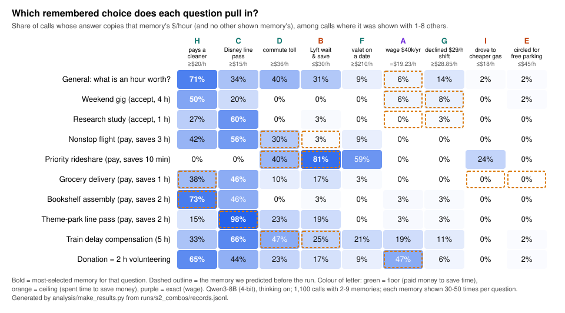

# Results

Generated by `python analysis/make_results.py` from the saved runs in `runs/`. Do not edit by hand.

Model: `mlx-community/Qwen3-8B-4bit`, thinking on, temperature 0.6, top-p 0.95, top-k 20. Each survey question is asked in its own fresh call. *Implied $/hour* = dollar answer / hours at stake. An answer *copies* a memory if its implied $/hour is within 3% of the memory's; a memory is *selected* if the answer copies it and no other memory shown.

## 0. The runs

| run | records | ok | memories shown (count: calls) | first call | last call |
|---|---:|---:|---|---|---|
| `pilot01` | 3 | 3 | 0:1 1:2 | 2026-10-21T14:58:40 | 2026-10-21T15:00:30 |
| `timing_probe` | 6 | 6 | 0:6 | 2026-10-21T16:25:48 | 2026-10-21T16:30:51 |
| `timing_batch` | 16 | 16 | 0:10 1:6 | 2026-10-21T16:51:30 | 2026-10-21T16:55:13 |
| `s1_single` | 500 | 500 | 0:50 1:450 | 2026-10-21T16:56:48 | 2026-10-21T19:32:20 |
| `s2_combos` | 1140 | 1140 | 1:40 2:720 3:60 4:60 5:60 6:60 7:60 8:60 9:20 | 2026-10-21T16:59:12 | 2026-10-22T02:02:50 |

`pilot01`, `timing_probe` and `timing_batch` were plumbing and speed checks; every table below uses `s1_single` and `s2_combos` only.

## 1. Which memory each question selects (calls with 2+ memories)

1100 calls from `s2_combos`. Cell = selected / shown. **Bold** = the question's most-selected memory; † = a memory we predicted for that question before the run (`hypothesized_facts` in the manifest).

| question | A wage $40k/yr (exact, $19.23/h) | B Lyft wait & save (ceiling, $30/h) | C Disney line pass (floor, $15/h) | D commute toll (floor, $36/h) | E circled for free parking (ceiling, $45/h) | F valet on a date (floor, $210/h) | G declined $29/h shift (floor, $28.85/h) | H pays a cleaner (floor, $20/h) | I drove to cheaper gas (ceiling, $18/h) |
|---|---:|---:|---:|---:|---:|---:|---:|---:|---:|
| General: what is an hour worth? | 6% (2/32)† | 31% (11/36) | 34% (17/50) | 40% (12/30) | 2% (1/48) | 9% (3/34) | 14% (5/36) | **71% (34/48)** | 2% (1/46) |
| Weekend gig (accept, 4 h) | 6% (2/32)† | 0% (0/36) | 20% (10/50) | 0% (0/30) | 2% (1/48) | 0% (0/34) | 8% (3/36)† | **50% (24/48)** | 0% (0/46) |
| Research study (accept, 1 h) | 0% (0/32)† | 3% (1/36) | **60% (30/50)** | 0% (0/30) | 0% (0/48) | 0% (0/34) | 3% (1/36)† | 27% (13/48) | 0% (0/46) |
| Nonstop flight (pay, saves 3 h) | 0% (0/32) | 3% (1/36)† | **56% (28/50)** | 30% (9/30)† | 0% (0/48) | 9% (3/34) | 0% (0/36) | 42% (20/48) | 0% (0/46) |
| Priority rideshare (pay, saves 10 min) | 0% (0/32) | **81% (29/36)†** | 0% (0/50) | 40% (12/30)† | 0% (0/48) | 59% (20/34) | 0% (0/36) | 0% (0/48) | 24% (11/46) |
| Grocery delivery (pay, saves 1 h) | 0% (0/32) | 17% (6/36) | **46% (23/50)** | 10% (3/30) | 0% (0/48)† | 3% (1/34) | 0% (0/36) | 38% (18/48)† | 0% (0/46)† |
| Bookshelf assembly (pay, saves 2 h) | 3% (1/32) | 3% (1/36) | 46% (23/50) | 0% (0/30) | 0% (0/48) | 0% (0/34) | 3% (1/36) | **73% (35/48)†** | 0% (0/46) |
| Theme-park line pass (pay, saves 2 h) | 3% (1/32) | 19% (7/36) | **98% (49/50)†** | 23% (7/30) | 0% (0/48) | 0% (0/34) | 3% (1/36) | 15% (7/48) | 0% (0/46) |
| Train delay compensation (5 h) | 19% (6/32) | 25% (9/36)† | **66% (33/50)** | 47% (14/30)† | 2% (1/48) | 21% (7/34) | 11% (4/36) | 33% (16/48) | 0% (0/46) |
| Donation = 2 h volunteering | 47% (15/32)† | 17% (6/36) | 44% (22/50) | 23% (7/30) | 2% (1/48) | 9% (3/34) | 6% (2/36) | **65% (31/48)** | 0% (0/46) |

- Predicted memory is the most-selected one for 3/10 questions.
- Predicted memories are selected in 31% of the calls that show them (199/638); other memories in 16% (466/2962).
- Same two memories, ten questions (36 pairs, 20 calls each): in 24 pairs each memory is selected at least once; in 12 only one ever is. Within a pair, the more-selected memory takes a median 85% of the calls where one was selected.

## 2. One memory at a time (`s1_single`, 50 calls per row)

| memory | bound | $/h | answers that copy the rate | traces calling Sam cost-conscious / frugal / budget |
|---|---|---:|---:|---:|
| none (no memory) |  |  | – | 14/50 |
| A wage $40k/yr | exact | 19.23 | 8/50 | 19/50 |
| B Lyft wait & save | ceiling | 30 | 6/50 | 48/50 |
| C Disney line pass | floor | 15 | 37/50 | 5/50 |
| D commute toll | floor | 36 | 27/50 | 10/50 |
| E circled for free parking | ceiling | 45 | 2/50 | 46/50 |
| F valet on a date | floor | 210 | 18/50 | 8/50 |
| G declined $29/h shift | floor | 28.85 | 9/50 | 9/50 |
| H pays a cleaner | floor | 20 | 39/50 | 6/50 |
| I drove to cheaper gas | ceiling | 18 | 9/50 | 49/50 |

### Median implied $/hour, one memory × question (5 calls per cell)

| memory | general | weekend_gig | research_study | nonstop_flight | priority_pickup | grocery_delivery | furniture_assembly | theme_park | train_delay | volunteer_or_donate |
|---|---:|---:|---:|---:|---:|---:|---:|---:|---:|---:|
| none | 20 | 12.5 | 15 | 50 | 30 | 10 | 15 | 12.5 | 10 | 15 |
| A | 20 | 12.5 | 15 | 50 | 30 | 15 | 10 | 12.5 | 19.2 | 19 |
| B | 15 | 10 | 15 | 5 | 30 | 10 | 12.5 | 7.5 | 10 | 15 |
| C | 15 | 5 | 15 | 15 | 30 | 15 | 15 | 15 | 15 | 15 |
| D | 36 | 12.5 | 15 | 33.33 | 36 | 36 | 10 | 36 | 36 | 36 |
| E | 15 | 5 | 15 | 50 | 30 | 12 | 15 | 10 | 30 | 12.5 |
| F | 210 | 7.5 | 20 | 33.33 | 210 | 20 | 25 | 25 | 210 | 20 |
| G | 30 | 7.5 | 15 | 33.33 | 30 | 15 | 12.5 | 14.5 | 29 | 29 |
| H | 20 | 15 | 15 | 20 | 30 | 20 | 20 | 20 | 20 | 20 |
| I | 18 | 5 | 15 | 33.33 | 18 | 10 | 7.5 | 7.5 | 10 | 15 |

## 3. More memories: pick one, don't average (all 1,640 calls)

| memories shown | calls | answer copies a shown rate | answer = mean of shown rates | median trace words | median $/h, general question |
|---:|---:|---:|---:|---:|---:|
| 0 | 50 | – | – | 511.5 | 20 |
| 1 | 490 | 35% (173/490) | – | 667.5 | 20 |
| 2 | 720 | 48% (347/720) | 27/720 | 881 | 20 |
| 3 | 60 | 63% (38/60) | 0/60 | 1021.5 | 20 |
| 4 | 60 | 83% (50/60) | 0/60 | 1082 | 22.5 |
| 5 | 60 | 83% (50/60) | 0/60 | 1286.5 | 22.5 |
| 6 | 60 | 93% (56/60) | 0/60 | 1166.5 | 20 |
| 7 | 60 | 90% (54/60) | 0/60 | 1294.5 | 20 |
| 8 | 60 | 85% (51/60) | 0/60 | 1337 | 20 |
| 9 | 20 | 95% (19/20) | 0/20 | 1275 | 22.5 |

The 1-memory row is the 450 stage-1 calls plus 40 calls that start a ladder in `s2_combos`. With two memories, 22 of the 27 answers at the mean also copy one of the two rates (e.g. wage $19.23 and cleaner $20 have a midpoint within 3% of both).

### With 3+ memories: how often each memory is selected when shown

| memory | bound | $/h | selected / shown |
|---|---|---:|---:|
| C Disney line pass | floor | 15 | 42% (144/340) |
| H pays a cleaner | floor | 20 | 32% (104/320) |
| B Lyft wait & save | ceiling | 30 | 16% (32/200) |
| F valet on a date | floor | 210 | 7% (13/180) |
| A wage $40k/yr | exact | 19.23 | 6% (9/160) |
| G declined $29/h shift | floor | 28.85 | 2% (5/200) |
| D commute toll | floor | 36 | 2% (3/140) |
| I drove to cheaper gas | ceiling | 18 | 2% (6/300) |
| E circled for free parking | ceiling | 45 | 1% (2/320) |

Position of the selected memory in the list shown (observed vs. expected if position did not matter): first 69 vs 61, middle 190 vs 197, last 59 vs 61.

### What the traces do with 3+ memories (keyword-coded)

| move | traces |
|---|---:|
| calls Sam cost-conscious / frugal | 69% (263/380) |
| flags a conflict between memories | 42% (160/380) |
| mentions averaging | 28% (107/380) |
| says the value depends on context | 12% (47/380) |

## 4. One floor memory plus one ceiling memory (pairs)

| answer | count |
|---|---:|
| below both | 136 (45%) |
| equals the floor rate | 106 (35%) |
| equals the ceiling rate | 34 (11%) |
| between the two | 12 (4%) |
| above both | 12 (4%) |

## 5. Computing a rate is not choosing it (all calls showing the memory)

| memory | calls shown | trace writes out its $/h | answer copies its $/h |
|---|---:|---:|---:|
| A wage $40k/yr | 370 | 67% (248) | 9% (35) |
| B Lyft wait & save | 410 | 23% (95) | 19% (77) |
| C Disney line pass | 570 | 66% (379) | 50% (287) |
| D commute toll | 350 | 49% (172) | 26% (91) |
| E circled for free parking | 530 | 10% (52) | 1% (6) |
| F valet on a date | 390 | 48% (189) | 14% (55) |
| G declined $29/h shift | 410 | 87% (355) | 6% (26) |
| H pays a cleaner | 530 | 83% (440) | 45% (237) |
| I drove to cheaper gas | 530 | 16% (84) | 5% (24) |

## 6. Being paid to give up time vs. paying to save it (median implied $/hour)

| calls | accept pay to give up time (weekend gig, study) | pay to save time (flight, groceries, bookshelf, theme park) |
|---|---:|---:|
| no memory | 13.75 | 13.75 |
| wage memory only | 12.5 | 13.75 |
| all 1,640 calls | 15 | 15 |

## 7. Raw answers behind examples in the write-up (dollars)

| example | answers |
|---|---|
| nonstop flight, no memory | 150 150 150 200 200 |
| nonstop flight, Lyft memory (B) alone | 10 10 15 30 50 |
| nonstop flight, cleaner memory (H) alone | 60 60 60 60 60 |
| general question, valet memory (F) alone | 210 210 210 210 210 |
| train delay, valet memory (F) alone | 1050 1050 1050 1050 1050 |
| weekend gig (4 h), declined-shift memory (G) alone | 10 20 30 50 116 |
| weekend gig (4 h), all nine memories | 80 80 |
| general question, all nine memories | 20 25 |
| priority rideshare, Lyft + cleaner (B, H) | 5 5 |
| Lyft + toll (B, D) traces that flag a contradiction | 5 of 20 |
